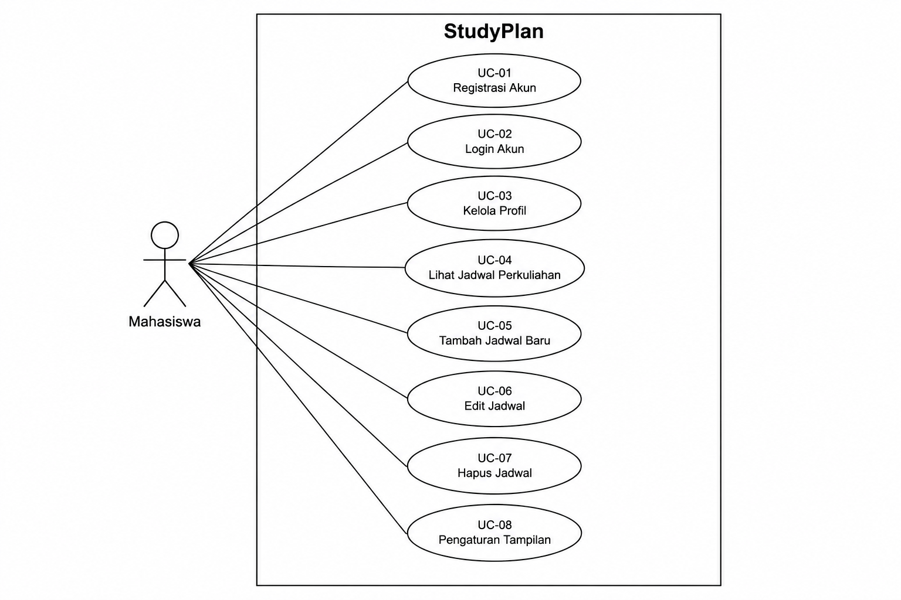
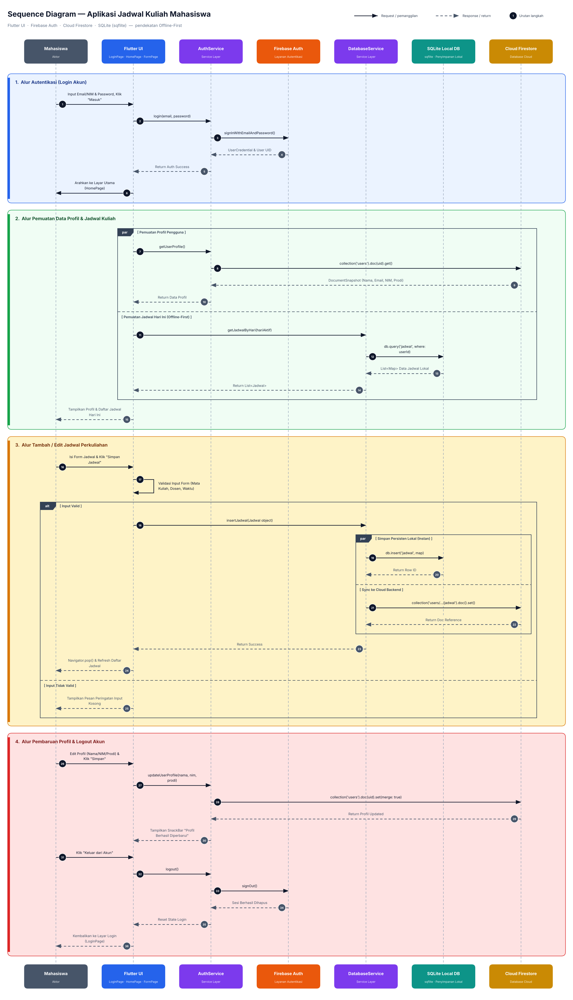
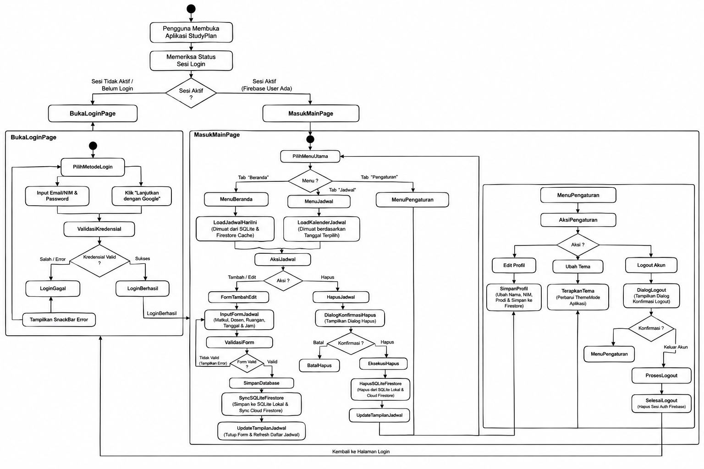
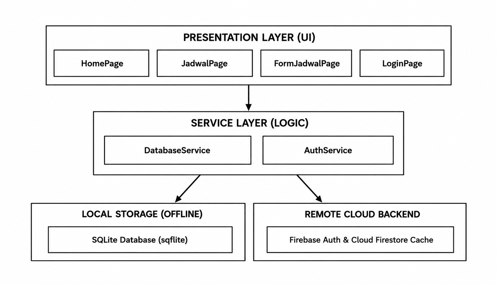

# 📚 Tugas Mata Kuliah: Analisis & Pengujian Sistem IF7A

**Mata Kuliah:** Analisis & Pengujian Sistem
**Proyek:** StudyPlan, Aplikasi Jadwal Kuliah Mahasiswa

## 👥 Anggota Kelompok

| No | Nama | NIM |
|----|------|-----|
| 1 | Trio Putra K | 23EO10027 |
| 2 | Latif Khanan Al Mansuri | 23EO10017 |
| 3 | Ghani Arif B | 23EO10038 |
| 4 | M Ismail Abdurouf | 23EO10031 |
| 5 | Fawaz Ari Najib | 23EO10008 |

---

## 📝 Deskripsi Proyek

Repositori ini berisi artefak, dokumen, dan kode yang berkaitan dengan tugas mata kuliah Analisis & Pengujian Sistem.

**StudyPlan** adalah aplikasi mobile untuk membantu mahasiswa mengelola jadwal perkuliahan secara praktis. Proyek ini bertujuan untuk menganalisis kebutuhan pengguna, merancang sistem menggunakan UML (Use Case, Sequence Diagram, Activity Diagram), merancang arsitektur aplikasi, dan mengimplementasikannya dengan pendekatan **Offline-First**, sehingga mahasiswa tetap dapat menambah, mengedit, dan melihat jadwal tanpa koneksi internet, lalu data disinkronkan ke cloud saat tersedia jaringan.

**Fitur utama:**
- Registrasi dan login (Email/NIM & Password atau Google Sign-In)
- Melihat jadwal hari ini dan kalender jadwal perkuliahan
- Tambah, edit, dan hapus jadwal (mata kuliah, dosen, ruangan, tanggal, jam)
- Kelola profil (nama, NIM, program studi)
- Pengaturan tema tampilan (Terang, Gelap, Sistem)

---

## 📝 Desain Proyek (Unified Modeling Language)

### 1. Use Case Diagram



Sistem StudyPlan memiliki satu aktor, yaitu **Mahasiswa**, dengan 8 use case:

| Kode | Use Case | Deskripsi Singkat |
|------|----------|-------------------|
| UC-01 | Registrasi Akun | Mahasiswa membuat akun baru. |
| UC-02 | Login Akun | Masuk menggunakan Email/NIM & Password atau akun Google. |
| UC-03 | Kelola Profil | Mengubah nama, NIM, dan program studi. |
| UC-04 | Lihat Jadwal Perkuliahan | Melihat jadwal hari ini (Beranda) dan jadwal berdasarkan tanggal (kalender). |
| UC-05 | Tambah Jadwal Baru | Menambahkan jadwal kuliah melalui form. |
| UC-06 | Edit Jadwal | Mengubah data jadwal yang sudah ada. |
| UC-07 | Hapus Jadwal | Menghapus jadwal setelah konfirmasi. |
| UC-08 | Pengaturan Tampilan | Mengubah tema aplikasi (Terang, Gelap, Sistem). |

### 2. Sequence Diagram



Sequence diagram menggambarkan interaksi antara **Mahasiswa, Flutter UI, AuthService, Firebase Auth, DatabaseService, SQLite Local DB, dan Cloud Firestore** dalam 4 alur utama:

1. **Autentikasi (Login Akun):** Mahasiswa mengisi email dan password, UI memanggil `AuthService.login()`, lalu diteruskan ke Firebase Auth (`signInWithEmailAndPassword`). Jika berhasil, pengguna diarahkan ke HomePage.
2. **Pemuatan Data Profil & Jadwal:** Dua proses berjalan paralel (`par`). Profil diambil dari Cloud Firestore (`users/{uid}`), sedangkan jadwal hari ini dibaca dari SQLite lokal (pendekatan Offline-First) sehingga tampil instan.
3. **Tambah / Edit Jadwal:** Form divalidasi terlebih dahulu (`alt`). Jika valid, `DatabaseService` menyimpan ke SQLite secara instan dan menyinkronkan ke Cloud Firestore secara paralel, lalu UI kembali dan me-refresh daftar jadwal. Jika tidak valid, ditampilkan pesan peringatan.
4. **Pembaruan Profil & Logout:** Profil diperbarui ke Firestore (`set(merge: true)`). Saat logout, `signOut()` dipanggil ke Firebase Auth, sesi dihapus, dan pengguna dikembalikan ke LoginPage.

### 3. Activity Diagram



Activity diagram menggambarkan alur aktivitas aplikasi dari awal dibuka:

- **Pengecekan sesi:** Saat aplikasi dibuka, sistem memeriksa status sesi login (Firebase User). Jika belum login, pengguna diarahkan ke **LoginPage**. Jika sesi aktif, pengguna langsung masuk ke **MainPage**.
- **Login:** Pengguna memilih metode login (Email/NIM & Password atau Google). Kredensial divalidasi. Jika salah, muncul SnackBar error dan pengguna mengulang. Jika benar, pengguna masuk ke MainPage.
- **MainPage:** Memiliki tiga menu (tab):
  - **Beranda:** memuat jadwal hari ini dari SQLite dan Firestore Cache.
  - **Jadwal:** memuat kalender jadwal berdasarkan tanggal terpilih.
  - **Pengaturan:** edit profil, ubah tema, dan logout.
- **Aksi Jadwal:**
  - *Tambah/Edit:* isi form, validasi, simpan ke SQLite, sinkronisasi ke Firestore, lalu tampilan diperbarui.
  - *Hapus:* tampil dialog konfirmasi. Jika dibatalkan tidak ada perubahan, jika dikonfirmasi data dihapus dari SQLite dan Firestore.
- **Pengaturan:** *Edit Profil* disimpan ke Firestore, *Ubah Tema* langsung diterapkan pada ThemeMode, dan *Logout* menampilkan dialog konfirmasi lalu menghapus sesi Firebase dan kembali ke halaman login.

---

## 📝 Arsitektur Proyek



StudyPlan menggunakan **Layered Architecture** dengan pendekatan **Offline-First**, terdiri dari empat bagian:

| Layer | Komponen | Peran |
|-------|----------|-------|
| **Presentation Layer (UI)** | `HomePage`, `JadwalPage`, `FormJadwalPage`, `LoginPage` | Menampilkan antarmuka dan menerima input pengguna. |
| **Service Layer (Logic)** | `DatabaseService`, `AuthService` | Menangani logika bisnis: operasi data jadwal dan autentikasi. |
| **Local Storage (Offline)** | SQLite Database (`sqflite`) | Menyimpan data jadwal di perangkat agar bisa diakses tanpa internet. |
| **Remote Cloud Backend** | Firebase Auth & Cloud Firestore | Autentikasi, penyimpanan profil dan jadwal di cloud, serta sinkronisasi data. |

**Alur umum:** Presentation Layer hanya berkomunikasi dengan Service Layer. Service Layer kemudian membaca/menulis ke SQLite (lokal) dan melakukan sinkronisasi ke Firebase (cloud). Dengan begitu UI tidak bergantung langsung pada sumber data.

---

## 🛠️ Tech Stack Aplikasi StudyPlan

### Frontend (FE): Flutter (Dart)
- Framework UI cross-platform dari Google untuk membangun aplikasi mobile native (Android & iOS).
- Menggunakan Material Design 3 dengan dukungan tema dinamis (Terang, Gelap, dan Sistem), kalender interaktif, serta tampilan responsif.

### Backend (BE): Firebase Backend-as-a-Service (BaaS)
- Arsitektur serverless dari Google yang menangani logika server, keamanan, dan manajemen data secara otomatis tanpa perlu mengelola server fisik/VPS terpisah.

### Database
1. **Cloud Database: Cloud Firestore (NoSQL Document Database)**
   - Database dokumen terpusat di cloud yang menyimpan profil pengguna (`users/{uid}`) dan koleksi jadwal perkuliahan (`users/{uid}/jadwal`). Dilengkapi fitur auto-sync real-time.
2. **Local Database: SQLite (paket `sqflite`)**
   - Database relasional lokal di perangkat untuk mendukung strategi Offline-First, sehingga pengguna tetap dapat menambah, mengedit, dan melihat jadwal tanpa internet.

### Service
1. **Authentication Service: Firebase Authentication**
   - Mengelola registrasi akun, verifikasi login Email & Password/NIM, keamanan kata sandi, serta Reset Password via Email.
2. **Identity Provider Service: Google Sign-In SDK (Google OAuth 2.0)**
   - Layanan Single Sign-On (SSO) agar pengguna dapat masuk menggunakan akun Google.

---

## 📁 Struktur Dokumentasi

```
.
├── README.md
└── docs/
    ├── use_case.png
    ├── sequence_diagram_jadwal_kuliah.png
    ├── Diagram_Activity.png
    └── Layered_Service_Architecture_Diagram.png
```
