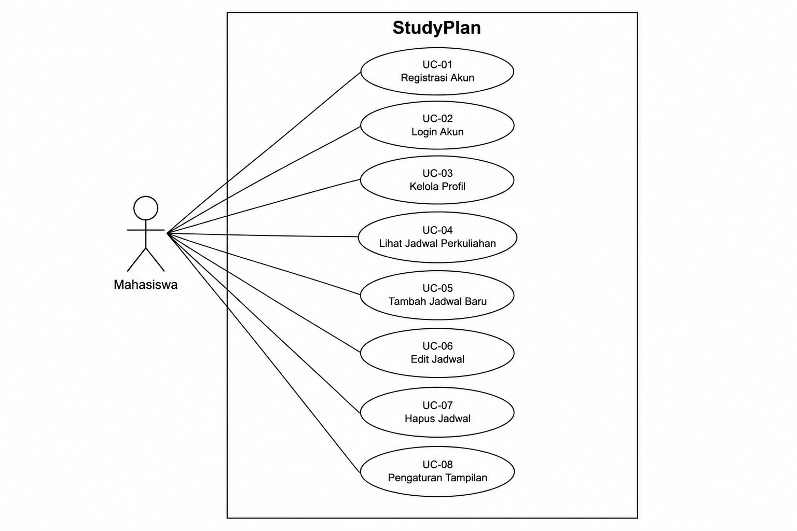
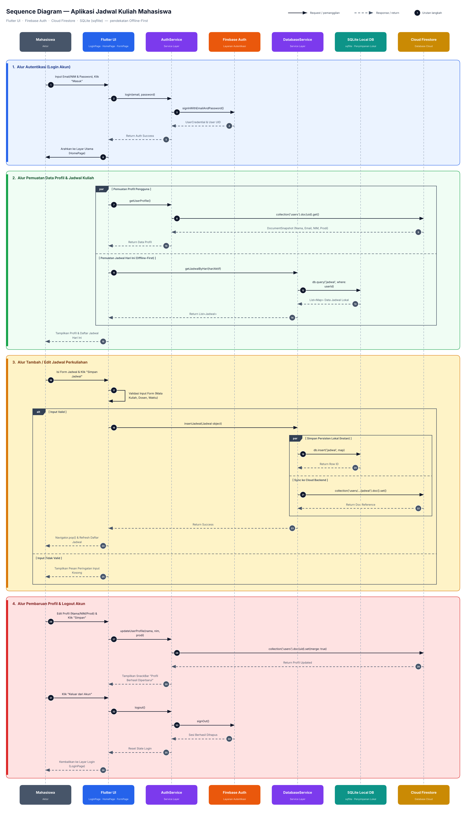
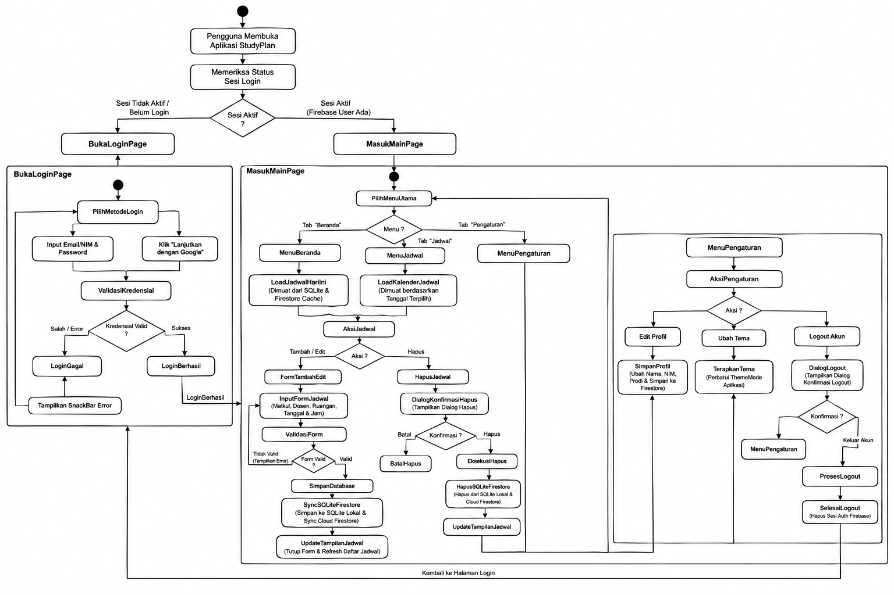
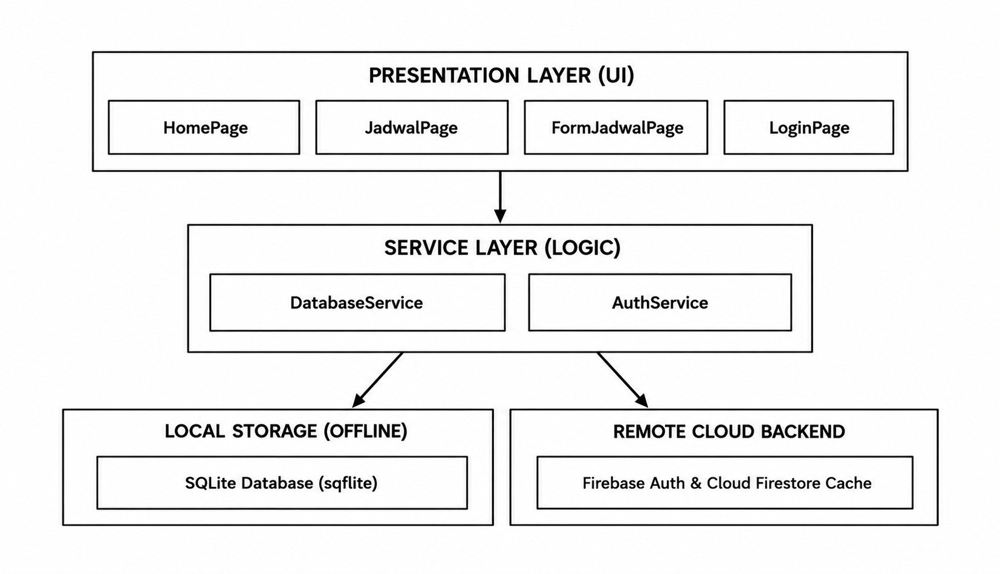

# 📚 Tugas Mata Kuliah: Analisis & Pengujian Sistem IF7A

**Mata Kuliah:** Analisis & Pengujian Sistem
**Proyek:** StudyPlan, Aplikasi Jadwal Kuliah Mahasiswa

## 👥 Anggota Kelompok

| No | Nama | NIM |
|----|------|-----|
| 1 | Trio Putra K | 23EO10027 |
| 2 | Latif Khanan Al Mansuri | 23EO10017 |
| 3 | Ghani Arif B | 23EO10038 |
| 4 | M Ismail Abdurouf | 23EO10031 |
| 5 | Fawaz Ari Najib | 23EO10008 |

---

## 📝 Deskripsi Proyek

Repositori ini berisi artefak, dokumen, dan kode yang berkaitan dengan tugas mata kuliah Analisis & Pengujian Sistem.

**StudyPlan** adalah aplikasi mobile untuk membantu mahasiswa mengelola jadwal perkuliahan secara praktis. Proyek ini bertujuan untuk menganalisis kebutuhan pengguna, merancang sistem menggunakan UML (Use Case, Sequence Diagram, Activity Diagram), merancang arsitektur aplikasi, dan mengimplementasikannya dengan pendekatan **Offline-First**, sehingga mahasiswa tetap dapat menambah, mengedit, dan melihat jadwal tanpa koneksi internet, lalu data disinkronkan ke cloud saat tersedia jaringan.

**Fitur utama:**
- Registrasi dan login (Email/NIM & Password atau Google Sign-In)
- Melihat jadwal hari ini dan kalender jadwal perkuliahan
- Tambah, edit, dan hapus jadwal (mata kuliah, dosen, ruangan, tanggal, jam)
- Kelola profil (nama, NIM, program studi)
- Pengaturan tema tampilan (Terang, Gelap, Sistem)

---

## 📝 Desain Proyek (Unified Modeling Language)

### 1. Use Case Diagram



Sistem StudyPlan memiliki satu aktor, yaitu **Mahasiswa**, dengan 8 use case:

| Kode | Use Case | Deskripsi Singkat |
|------|----------|-------------------|
| UC-01 | Registrasi Akun | Mahasiswa membuat akun baru. |
| UC-02 | Login Akun | Masuk menggunakan Email/NIM & Password atau akun Google. |
| UC-03 | Kelola Profil | Mengubah nama, NIM, dan program studi. |
| UC-04 | Lihat Jadwal Perkuliahan | Melihat jadwal hari ini (Beranda) dan jadwal berdasarkan tanggal (kalender). |
| UC-05 | Tambah Jadwal Baru | Menambahkan jadwal kuliah melalui form. |
| UC-06 | Edit Jadwal | Mengubah data jadwal yang sudah ada. |
| UC-07 | Hapus Jadwal | Menghapus jadwal setelah konfirmasi. |
| UC-08 | Pengaturan Tampilan | Mengubah tema aplikasi (Terang, Gelap, Sistem). |

### 2. Sequence Diagram



Sequence diagram menggambarkan interaksi antara **Mahasiswa, Flutter UI, AuthService, Firebase Auth, DatabaseService, SQLite Local DB, dan Cloud Firestore** dalam 4 alur utama:

1. **Autentikasi (Login Akun):** Mahasiswa mengisi email dan password, UI memanggil `AuthService.login()`, lalu diteruskan ke Firebase Auth (`signInWithEmailAndPassword`). Jika berhasil, pengguna diarahkan ke HomePage.
2. **Pemuatan Data Profil & Jadwal:** Dua proses berjalan paralel (`par`). Profil diambil dari Cloud Firestore (`users/{uid}`), sedangkan jadwal hari ini dibaca dari SQLite lokal (pendekatan Offline-First) sehingga tampil instan.
3. **Tambah / Edit Jadwal:** Form divalidasi terlebih dahulu (`alt`). Jika valid, `DatabaseService` menyimpan ke SQLite secara instan dan menyinkronkan ke Cloud Firestore secara paralel, lalu UI kembali dan me-refresh daftar jadwal. Jika tidak valid, ditampilkan pesan peringatan.
4. **Pembaruan Profil & Logout:** Profil diperbarui ke Firestore (`set(merge: true)`). Saat logout, `signOut()` dipanggil ke Firebase Auth, sesi dihapus, dan pengguna dikembalikan ke LoginPage.

### 3. Activity Diagram



Activity diagram menggambarkan alur aktivitas aplikasi dari awal dibuka:

- **Pengecekan sesi:** Saat aplikasi dibuka, sistem memeriksa status sesi login (Firebase User). Jika belum login, pengguna diarahkan ke **LoginPage**. Jika sesi aktif, pengguna langsung masuk ke **MainPage**.
- **Login:** Pengguna memilih metode login (Email/NIM & Password atau Google). Kredensial divalidasi. Jika salah, muncul SnackBar error dan pengguna mengulang. Jika benar, pengguna masuk ke MainPage.
- **MainPage:** Memiliki tiga menu (tab):
  - **Beranda:** memuat jadwal hari ini dari SQLite dan Firestore Cache.
  - **Jadwal:** memuat kalender jadwal berdasarkan tanggal terpilih.
  - **Pengaturan:** edit profil, ubah tema, dan logout.
- **Aksi Jadwal:**
  - *Tambah/Edit:* isi form, validasi, simpan ke SQLite, sinkronisasi ke Firestore, lalu tampilan diperbarui.
  - *Hapus:* tampil dialog konfirmasi. Jika dibatalkan tidak ada perubahan, jika dikonfirmasi data dihapus dari SQLite dan Firestore.
- **Pengaturan:** *Edit Profil* disimpan ke Firestore, *Ubah Tema* langsung diterapkan pada ThemeMode, dan *Logout* menampilkan dialog konfirmasi lalu menghapus sesi Firebase dan kembali ke halaman login.

---

## 📝 Arsitektur Proyek



StudyPlan menggunakan **Layered Architecture** dengan pendekatan **Offline-First**, terdiri dari empat bagian:

| Layer | Komponen | Peran |
|-------|----------|-------|
| **Presentation Layer (UI)** | `HomePage`, `JadwalPage`, `FormJadwalPage`, `LoginPage` | Menampilkan antarmuka dan menerima input pengguna. |
| **Service Layer (Logic)** | `DatabaseService`, `AuthService` | Menangani logika bisnis: operasi data jadwal dan autentikasi. |
| **Local Storage (Offline)** | SQLite Database (`sqflite`) | Menyimpan data jadwal di perangkat agar bisa diakses tanpa internet. |
| **Remote Cloud Backend** | Firebase Auth & Cloud Firestore | Autentikasi, penyimpanan profil dan jadwal di cloud, serta sinkronisasi data. |

**Alur umum:** Presentation Layer hanya berkomunikasi dengan Service Layer. Service Layer kemudian membaca/menulis ke SQLite (lokal) dan melakukan sinkronisasi ke Firebase (cloud). Dengan begitu UI tidak bergantung langsung pada sumber data.

---

## 🛠️ Tech Stack Aplikasi StudyPlan

### Frontend (FE): Flutter (Dart)
- Framework UI cross-platform dari Google untuk membangun aplikasi mobile native (Android & iOS).
- Menggunakan Material Design 3 dengan dukungan tema dinamis (Terang, Gelap, dan Sistem), kalender interaktif, serta tampilan responsif.

### Backend (BE): Firebase Backend-as-a-Service (BaaS)
- Arsitektur serverless dari Google yang menangani logika server, keamanan, dan manajemen data secara otomatis tanpa perlu mengelola server fisik/VPS terpisah.

### Database
1. **Cloud Database: Cloud Firestore (NoSQL Document Database)**
   - Database dokumen terpusat di cloud yang menyimpan profil pengguna (`users/{uid}`) dan koleksi jadwal perkuliahan (`users/{uid}/jadwal`). Dilengkapi fitur auto-sync real-time.
2. **Local Database: SQLite (paket `sqflite`)**
   - Database relasional lokal di perangkat untuk mendukung strategi Offline-First, sehingga pengguna tetap dapat menambah, mengedit, dan melihat jadwal tanpa internet.

### Service
1. **Authentication Service: Firebase Authentication**
   - Mengelola registrasi akun, verifikasi login Email & Password/NIM, keamanan kata sandi, serta Reset Password via Email.
2. **Identity Provider Service: Google Sign-In SDK (Google OAuth 2.0)**
   - Layanan Single Sign-On (SSO) agar pengguna dapat masuk menggunakan akun Google.

---

## 📁 Struktur Dokumentasi

```
.
├── README.md
└── docs/
    ├── use_case.png
    ├── sequence_diagram_jadwal_kuliah.png
    ├── Diagram_Activity.png
    └── Layered_Service_Architecture_Diagram.png
```

---

## 🧪 BDD Automation / Integration Testing dengan Maestro

Flow Maestro berada di `.maestro/flows/`, dengan alur login reusable di `.maestro/subflows/login.yaml`. Skenario dijalankan pada aplikasi Android melalui UI:

| Skenario | Given | When | Then |
|----------|-------|------|------|
| Validasi field login | Pengguna berada di halaman login | Menekan **Masuk** tanpa mengisi field | Pesan wajib isi email/NIM dan kata sandi tampil |
| Validasi email reset kata sandi | Pengguna membuka halaman **Lupa kata sandi?** | Mengisi email dengan format tidak valid dan mengirim form | Pesan format email tidak valid tampil; request Firebase tidak dikirim |
| CRUD jadwal | Pengguna login dengan akun uji | Membuat, mengedit, lalu menghapus jadwal | Perubahan tampil dan data uji terhapus |
| Catatan | Pengguna login dengan akun uji | Membuat lalu menghapus catatan | Catatan tampil dan kemudian terhapus |
| Verifikasi sesi login | Pengguna sudah login | Menjalankan `verify-authenticated-session.yaml` tanpa menghapus state | Sapaan akun uji tampil di Beranda; flow ini memverifikasi sesi yang ada, bukan kredensial |

### Menjalankan test

1. Siapkan Android Emulator atau perangkat Android, aktifkan USB debugging jika menggunakan perangkat, dan pastikan aplikasi dapat dibangun dengan Flutter.
2. Pasang Maestro CLI mengikuti [petunjuk instalasi resmi](https://docs.maestro.dev/maestro-cli/how-to-install-maestro-cli.md). Pastikan Java 17+ tersedia.
3. Build dan install APK debug:

   ```powershell
   flutter build apk --debug
   adb install -r build\app\outputs\flutter-apk\app-debug.apk
   ```

4. Siapkan akun Firebase khusus testing. Ganti nilai contoh di bawah dengan email/password akun yang benar-benar sudah terdaftar; teks `email-akun-uji` dan `password-akun-uji` bukan kredensial yang bisa dipakai. Jangan simpan kredensial di file flow atau commit ke repository:

   ```powershell
   $env:TEST_EMAIL = "email-akun-uji"
   $env:TEST_PASSWORD = "password-akun-uji"
   $env:TEST_RUN_ID = "run-unik-001"
   ```

5. Jalankan flow validasi publik tanpa akun:

   ```powershell
   maestro test .maestro\flows\login-required-fields.yaml
   maestro test .maestro\flows\password-reset-invalid-email.yaml
   ```

6. Jalankan flow terautentikasi:

   ```powershell
   maestro test -e TEST_EMAIL=$env:TEST_EMAIL -e TEST_PASSWORD=$env:TEST_PASSWORD -e TEST_RUN_ID=$env:TEST_RUN_ID .maestro\flows\schedule-crud.yaml
   maestro test -e TEST_EMAIL=$env:TEST_EMAIL -e TEST_PASSWORD=$env:TEST_PASSWORD -e TEST_RUN_ID=$env:TEST_RUN_ID .maestro\flows\notes-create-delete.yaml
   maestro test .maestro\flows\verify-authenticated-session.yaml
   ```

Gunakan `TEST_RUN_ID` yang berbeda setiap kali menjalankan flow. Setiap flow menghapus state aplikasi saat mulai; flow CRUD menghapus data yang berhasil dibuat di akhir skenario. Flow jadwal juga memeriksa jadwal yang baru dibuat pada Beranda dan tab Jadwal. Kedua tab memuat ulang data ketika dibuka dan memakai aturan pencarian tanggal/hari yang sama. Artefak Maestro dapat memuat log interaksi; periksa dan samarkan informasi akun sebelum membagikan folder report.

---

## 🧪 Pengujian, Linter, dan Analisis Kualitas

Bagian ini menjelaskan cara menjalankan pemeriksaan kualitas StudyPlan dari terminal. Perintah terminal di bawah menggunakan **PowerShell** dan dijalankan dari root repository.

### 1. Unit Test — Wajib

Unit test memeriksa satu bagian aplikasi secara terisolasi, tanpa harus menjalankan seluruh aplikasi di perangkat. Test Flutter/Dart berada di folder `test/` dan memakai `flutter_test`. Fake service dan platform mock digunakan untuk menguji alur autentikasi dan notifikasi tanpa menghubungi layanan eksternal. `DatabaseService` diuji memakai SQLite FFI di database sementara.

Cakupan skenario yang tersedia:

| Area | Skenario yang diuji |
|------|----------------------|
| Model jadwal dan catatan | Konversi data, nilai default, dan kompatibilitas data pengingat jadwal. |
| Login | Validasi input kosong, tampil/sembunyi kata sandi, navigasi ke reset kata sandi dan registrasi, error login, Google Sign-In dibatalkan/gagal, serta callback login berhasil. |
| Autentikasi | Registrasi/login, profil pengguna dan NIM, reset kata sandi, logout, serta alur Google Sign-In menggunakan platform palsu. |
| Database lokal | CRUD jadwal dan catatan, filter berdasarkan tanggal/hari/mata kuliah, pemilihan jadwal untuk tanggal, dan urutan catatan. |
| Halaman beranda dan kalender | Tampilan data, navigasi bulan, pemilihan hari, pemuatan ulang halaman saat tab aktif, dan navigasi ke form. |
| Form jadwal | Validasi field wajib, edit data, pemilihan tanggal/waktu, alarm aktif/nonaktif, dan pemilihan pengingat. |
| Catatan dan tugas | Tampilan kosong, pencarian, filter kategori, validasi form, tambah/edit, konfirmasi hapus, serta pemuatan ulang saat tab aktif. |
| Pengaturan | Pemilihan tema, validasi dan pembaruan profil, pilihan nada dering, serta konfirmasi logout. |
| Widget dan dialog | Tampilan kartu jadwal pada layar sempit, dialog hapus jadwal, dan dialog konfirmasi logout. |
| Notifikasi | Preferensi nada dering, izin platform, penjadwalan alarm, pengingat yang didukung, fallback ketika alarm exact gagal, dan pembatalan notifikasi melalui mock channel. |

File test per area antara lain `test/pages/login_page_test.dart`, `test/services/auth_service_test.dart`, `test/services/database_service_test.dart`, dan `test/services/notification_service_test.dart`.

Langkah menjalankan semua test:

```powershell
cd C:\studyplan
flutter pub get
flutter test
```

Untuk menjalankan satu file test tertentu:

```powershell
flutter test test\pages\login_page_test.dart
```

Untuk menjalankan satu test berdasarkan nama:

```powershell
flutter test test\pages\login_page_test.dart --plain-name "menampilkan validasi saat login tanpa input"
```

Hasil terakhir yang diverifikasi pada repository: **69 test lulus**. Ini adalah hasil lokal saat dokumentasi ini diperbarui; hasil pada mesin atau commit berikutnya dapat berbeda.

### 2. Implementasi Linter — Wajib

Linter proyek memakai paket `flutter_lints` yang sudah tercantum di `dev_dependencies` pada `pubspec.yaml`. Aturan Flutter/Dart diaktifkan melalui `analysis_options.yaml` dengan:

```yaml
include: package:flutter_lints/flutter.yaml
```

Jalankan pemeriksaan statis dari root proyek:

```powershell
flutter analyze
```

Perintah ini tidak menjalankan aplikasi atau test; ia menganalisis kode Dart, menemukan diagnostic seperti error, warning, dan pelanggaran lint. Hasil terakhir yang diverifikasi: **No issues found**. GitHub Actions menjalankan `flutter analyze` pada setiap push ke `main` dan pull request.

### 3. Integration Testing — Opsional

Integration test memverifikasi alur yang menghubungkan beberapa bagian aplikasi sekaligus melalui UI, bukan hanya memanggil fungsi terisolasi. Di proyek ini, automation UI Android ditulis dengan Maestro di `.maestro/flows/`. Skenario mencakup validasi login, reset password, CRUD jadwal, pembuatan/penghapusan catatan, dan verifikasi sesi.

Cara menjalankannya serta persiapan emulator/perangkat, APK, Maestro CLI, dan akun Firebase testing dijelaskan pada bagian [BDD Automation / Integration Testing dengan Maestro](#-bdd-automation--integration-testing-dengan-maestro) di atas.

**Status yang tercatat:** laporan `.maestro/reports/schedule-crud-report.md` menyebut smoke test tampilan field login lulus, tetapi login akun testing belum terverifikasi penuh dan CRUD jadwal lengkap terhenti karena koneksi Maestro ke perangkat (`DeviceServerDiedException`, status `UNAVAILABLE`). Karena itu, laporan tersebut **belum membuktikan bahwa integration flow CRUD berhasil**. Jalankan ulang flow pada perangkat yang koneksinya stabil untuk memperoleh hasil terbaru.

### 4. Integrasi SonarCloud (Static Code Analysis) — Wajib

Konfigurasi analisis berada di `sonar-project.properties`:

- Project key dan organisasi SonarCloud.
- Source aplikasi: `lib`; direktori test: `test`.
- Laporan coverage Dart: `coverage/lcov.info`.
- File hasil generate dan platform dikecualikan dari analisis sesuai aturan di file konfigurasi.

Workflow `.github/workflows/build.yml` menjalankan `flutter pub get`, `flutter analyze`, `flutter test --coverage`, build APK debug, lalu SonarCloud scan. Workflow berjalan pada push ke `main` atau pull request. Agar job CI dapat mengirim hasil, repository GitHub harus memiliki Actions secret bernama `SONAR_TOKEN` yang berisi token SonarCloud. Token jangan ditulis ke source code atau commit.

Untuk menjalankan scan **manual di Windows PowerShell**:

1. Pastikan Flutter dan SonarScanner CLI sudah terpasang. Periksa scanner dengan `sonar-scanner --version`, atau gunakan lokasi file `.bat` scanner yang terpasang di komputer.
2. Dari root proyek, masukkan token sebagai environment variable. PowerShell meminta token secara tersembunyi:

   ```powershell
   cd C:\studyplan
   $secureToken = Read-Host "Masukkan SONAR_TOKEN" -AsSecureString
   $env:SONAR_TOKEN = [System.Net.NetworkCredential]::new("", $secureToken).Password
   ```

3. Buat laporan coverage dengan menjalankan test. Pastikan test berhasil sebelum melakukan scan:

   ```powershell
   flutter test --coverage
   if ($LASTEXITCODE -ne 0) { throw "Test gagal; scan SonarCloud dibatalkan." }
   ```

4. Jalankan SonarScanner. Jika `sonar-scanner` tersedia di `PATH`:

   ```powershell
   sonar-scanner
   ```

   Jika tidak, panggil file `sonar-scanner.bat` menggunakan path instalasi lokal, misalnya:

   ```powershell
   & "C:\tools\sonar-scanner-cli\bin\sonar-scanner.bat"
   ```

5. Setelah proses selesai, hapus token dari sesi terminal:

   ```powershell
   Remove-Item Env:SONAR_TOKEN -ErrorAction SilentlyContinue
   ```

SonarScanner membaca konfigurasi proyek dan mengunggah hasil analisis ke SonarCloud. Buka dashboard project `latifkhanan_studyplan` untuk melihat hasil scan dan status Quality Gate. Jika PowerShell menampilkan prompt `>>`, tekan `Ctrl+C` untuk kembali ke prompt normal sebelum memasukkan perintah.

### 5. Kriteria Penilaian SonarCloud — Opsional

Kriteria yang dapat diperiksa pada dashboard SonarCloud:

| Kriteria | Makna umum |
|----------|------------|
| **Reliability: A** | Rating keandalan berdasarkan bug yang ditemukan SonarCloud. Rating A berarti tidak ada atau hanya tingkat dampak terendah menurut aturan rating SonarCloud yang berlaku. |
| **Maintainability: A** | Rating kemudahan pemeliharaan berdasarkan code smell dan perkiraan technical debt. |
| **Security: A** | Rating berdasarkan kerentanan keamanan yang terdeteksi. Ini bukan jaminan bahwa aplikasi bebas dari semua risiko keamanan. Security Hotspots juga perlu ditinjau dan ditandai sesuai hasil pemeriksaan. |
| **Coverage ≥ 80%** | Persentase baris kode yang dieksekusi oleh test, berdasarkan laporan coverage yang dibaca SonarCloud. |

Coverage lokal terakhir yang diverifikasi adalah **82,34% (2.509 dari 3.047 baris)**, dihitung dari LCOV setelah `flutter test --coverage`. Ini mengukur laporan lokal, bukan bukti bahwa Quality Gate SonarCloud sudah lulus. Pastikan scan berhasil dan periksa dashboard untuk rating serta coverage yang dilaporkan server. Coverage saja tidak menentukan nilai Reliability, Maintainability, atau Security.

### Unit Testing: langkah dan hasil

Berikut urutan singkat untuk menjalankan unit test secara mandiri:

1. Buka PowerShell dan masuk ke repository:

   ```powershell
   cd C:\studyplan
   ```

2. Unduh/resolusikan dependency jika ini pertama kali dijalankan atau dependency berubah:

   ```powershell
   flutter pub get
   ```

3. Jalankan seluruh unit/widget test:

   ```powershell
   flutter test
   ```

4. Perhatikan ringkasan di terminal. Jika berhasil, Flutter menampilkan `All tests passed!` dan jumlah test yang lulus. Jika gagal, baca nama test dan pesan error, perbaiki penyebabnya, lalu ulangi.

5. Jika perlu mengirim coverage ke SonarCloud, jalankan perintah coverage sebagai pengganti langkah 3:

   ```powershell
   flutter test --coverage
   ```

   Perintah ini juga menjalankan test suite dan menulis `coverage/lcov.info`. File tersebut dibuat otomatis dan tidak perlu di-commit.

**Hasil terakhir yang diverifikasi:** `flutter test --coverage` menyelesaikan seluruh **69 test dengan sukses** (`All tests passed!`), dan coverage lokal sebesar **82,34%**. Hasil ini adalah baseline terakhir yang tercatat; jalankan kembali perintah di atas untuk memperoleh hasil aktual dari perubahan kode saat ini.
